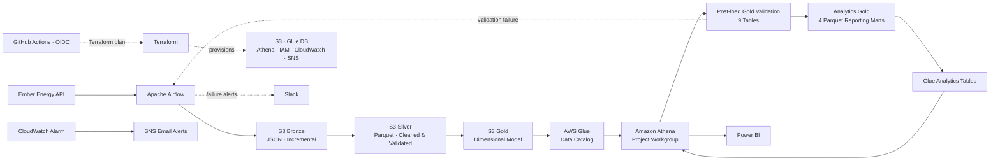

# European Energy Data Analytics

End-to-end ELT and analytics project for monthly European electricity data from the Ember Energy API.

## Architecture



## Tech Stack

Python · pandas · Apache Airflow · Docker · Terraform · GitHub Actions · Amazon S3 · AWS Glue · Amazon Athena · Parquet · SQL · Power BI

## Highlights

- Incremental monthly API ingestion with persistent S3 state
- Targeted historical backfills for controlled scope expansion without modifying incremental state
- Bronze / Silver / Gold medallion architecture
- Automated Silver and Gold data-quality checks before persistence, followed by Athena post-load validation of all nine Gold tables
- Dimensional Gold model with conformed dimensions
- Coverage of 41 Ember-supported European markets across the core monthly datasets
- Dataset-specific source coverage for installed capacity
- Monthly Airflow orchestration and Slack failure notifications
- CloudWatch alarm for Athena failed queries, routed through SNS email alerts
- Infrastructure as Code for S3, Glue database, Athena workgroup and IAM
- Versioned and encrypted S3 remote Terraform state with native locking
- CI checks for pytest and Terraform formatting/validation; AWS-authenticated Terraform planning via GitHub OIDC with a guard against delete/replacement operations
- Serverless SQL analytics through the dedicated `european-energy-analytics` Athena workgroup
- Power BI reporting over the existing nine-table Core Gold model through Athena
- Four additive Analytics Gold reporting marts, published as validated Parquet snapshots with unchanged-result detection

## Infrastructure, CI/CD and Monitoring

Terraform manages the AWS infrastructure under [`infra/terraform/`](infra/terraform/), including S3, Glue, Athena, IAM, CloudWatch monitoring and SNS notifications. Remote Terraform state is stored in a separate encrypted, versioned S3 backend with native locking. Bootstrap IAM roles and policies support GitHub Actions authentication through OIDC and short-lived AWS credentials.

The Terraform CI workflow validates configuration, generates an AWS-backed saved plan and blocks plans containing delete or replacement actions. A passing plan check does **not** automatically apply infrastructure changes. Apply operations require an explicit, reviewed procedure; see [Architecture](docs/architecture/architecture.md) for the separation of responsibilities.

Airflow sends task failure notifications to Slack. CloudWatch monitors Athena failed-query metrics and routes alarm notifications through the existing SNS email topic.

## Getting Started and Operations

The project runs Apache Airflow locally with Docker Compose and uses AWS services in `eu-central-1`. You will need Python 3.12, Docker Desktop, AWS CLI, Terraform >= 1.16 and authorized access to the existing project AWS environment. **Cloning the repository does not provision an independent AWS environment**: the Terraform backend points to the project's existing remote state.

### Local setup

```powershell
git clone https://github.com/georgeballa7/EuropeanEnergyDataAnalytics.git
cd EuropeanEnergyDataAnalytics
Copy-Item .env.example .env
# Set EMBER_API_KEY in .env; never commit credentials
python -m pip install -r requirements.txt
python -m pytest -v
```

Configure the `energy-pipeline` AWS CLI profile and verify the target identity before running cloud operations:

```powershell
aws sts get-caller-identity --profile energy-pipeline
```

### Run Airflow

```powershell
docker compose -f airflow/docker-compose.yaml build
docker compose -f airflow/docker-compose.yaml run --rm airflow-init
docker compose -f airflow/docker-compose.yaml up -d
docker compose -f airflow/docker-compose.yaml ps
```

Open the Airflow UI at [localhost:8081](http://localhost:8081). Check the DAG and AWS credentials before triggering a run; manual runs can incur AWS charges. Inspect service logs with `docker compose -f airflow/docker-compose.yaml logs --tail=100 airflow-scheduler`. Stop services without removing local metadata using `docker compose -f airflow/docker-compose.yaml down`.

### Infrastructure and verification

Terraform is configured in `infra/terraform/`. To validate configuration **without accessing or modifying remote state**:

```powershell
cd infra/terraform
terraform fmt -check -recursive
terraform init -backend=false
terraform validate
```

Infrastructure changes require explicit review; CI validates and guards Terraform plans but does not automatically apply them. After a controlled pipeline run, verify all six Airflow tasks, including `validate_persisted_gold` and `publish_analytics_gold`, along with Bronze objects, Silver/Gold snapshots, Glue tables and Athena validation results.

For complete setup requirements, troubleshooting, safe recovery procedures and the reproducibility checklist, see the **[Local Setup and Operations Runbook](docs/operations/runbook.md)**.

## Data Coverage

The project scope contains 41 European markets available from Ember. Electricity generation, demand, power-sector emissions and carbon intensity use the full configured European scope. Installed capacity uses a smaller dataset-specific country scope because Ember provides monthly capacity data for fewer markets.

The regular pipeline remains incremental. Historical scope expansions are handled through an explicit backfill workflow that writes source responses to Bronze without changing the persistent incremental ingestion state. Silver and Gold snapshots are then rebuilt and validated from the expanded source history.

## Power BI Dashboard


[View the complete Power BI report (PDF)](powerbi/EuropeanEnergyAnalytics.pdf)

## Analytics

The project analyses electricity generation and demand, energy-mix transition, power-sector emissions and carbon intensity, and installed solar and wind capacity. The final Athena SQL queries are available in [`sql/analytics/`](sql/analytics/).

### Analytics Gold reporting marts

After the persisted Core Gold quality gate succeeds, the sixth Airflow task
(`publish_analytics_gold`) materializes four **additional** Parquet reporting marts.
The original nine Core Gold tables and existing Power BI model remain unchanged.

| Glue table | Verified rows (2026-10-14) | Purpose |
| --- | ---: | --- |
| `analytics_generation_demand_summary` | 38 | Generation and demand change |
| `analytics_energy_mix_transition_summary` | 38 | Renewable, fossil and clean generation shares |
| `analytics_emissions_carbon_intensity` | 38 | Emissions and carbon intensity |
| `analytics_installed_solar_wind_capacity` | 10 | Installed solar and wind capacity |

These row counts are **not** the total configured market scope. The core
project covers 41 markets; reporting SQL applies period-availability criteria,
and the capacity source has narrower country coverage. The published tables
were verified by querying `COUNT(*)` in Athena on 2026-10-14.

The publisher reads each reporting result, computes a SHA-256 fingerprint from
the SQL, column metadata and order-independent result rows, and compares it
with the fingerprint stored on the corresponding Glue table. If unchanged, it
skips Parquet UNLOAD and leaves the S3 snapshot location untouched. Otherwise
it writes a new immutable Parquet snapshot under
`gold/analytics/<mart>/snapshots/<uuid>/`, registers a temporary Glue table,
validates nonempty data, required dimensions and unique country-period rows,
then updates the final Glue table and removes the temporary table.

**Operational limitations:** unchanged-result idempotency has been confirmed
by two successive publisher runs and an end-to-end six-task Airflow run.
The four Glue updates are **not an atomic transaction**: partial success
requires rerunning the publisher, which skips unchanged completed marts.
Failed attempts may leave unreferenced S3 snapshots, so cleanup must be
deliberate and must never delete a snapshot referenced by Glue. Concurrent
publishers are not protected by a distributed lock; avoid overlapping runs.
The fingerprint check also assumes the already-published snapshot has not
been externally modified. This workflow is not a guarantee of exactly-once
execution or atomic multi-table publication.


## Documentation

- [Architecture](docs/architecture/architecture.md)
- [Gold Data Model / ERD](docs/architecture/gold_erd.md)
- [Data Dictionary](docs/data_dictionary/data_dictionary.md)
- [Data Quality](docs/data_quality.md)
- [Architecture Decisions](docs/decisions/architecture_decisions.md)

Exploration, data understanding and EDA are documented in [`notebooks/`](notebooks/).
