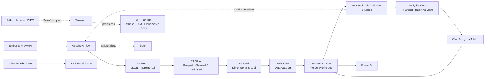
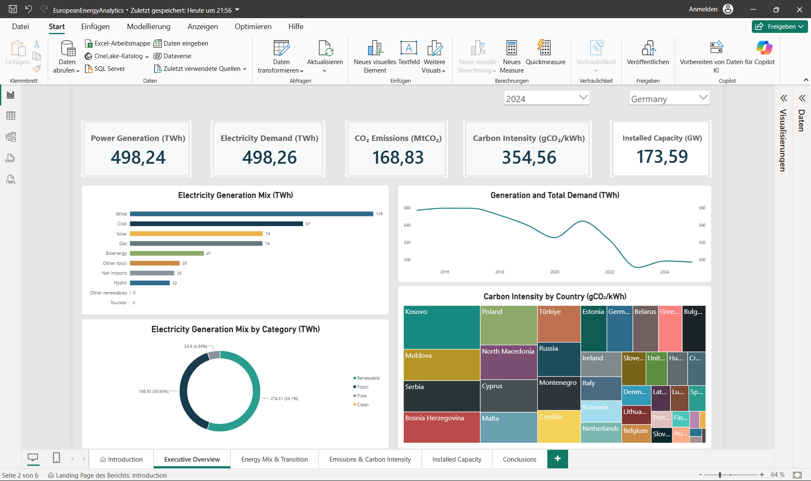

# European Energy Data Analytics

End-to-end ELT and analytics project for monthly European electricity data from the Ember Energy API.

## Architecture



## Tech Stack

Python · pandas · Apache Airflow · Docker · Terraform · GitHub Actions · Amazon S3 · AWS Glue · Amazon Athena · Parquet · SQL · Power BI

## Highlights

- Incremental monthly API ingestion with persistent S3 state
- Targeted historical backfills for controlled scope expansion without modifying incremental state
- Bronze / Silver / Gold medallion architecture
- Automated Silver and Gold data-quality checks before persistence, followed by Athena post-load validation of all nine Gold tables
- Dimensional Gold model with conformed dimensions
- Coverage of 41 Ember-supported European markets across the core monthly datasets
- Dataset-specific source coverage for installed capacity
- Monthly Airflow orchestration and Slack failure notifications
- CloudWatch alarm for Athena failed queries, routed through SNS email alerts
- Infrastructure as Code for S3, Glue database, Athena workgroup and IAM
- Versioned and encrypted S3 remote Terraform state with native locking
- CI checks for pytest and Terraform formatting/validation; AWS-authenticated Terraform planning via GitHub OIDC with a guard against delete/replacement operations
- Serverless SQL analytics through the dedicated `european-energy-analytics` Athena workgroup
- Power BI reporting over the existing nine-table Core Gold model through Athena
- Four additive Analytics Gold reporting marts, prepared and validated before Glue publication, with unchanged-result detection and best-effort rollback

## Infrastructure, CI/CD and Monitoring

Terraform manages the AWS infrastructure under [`infra/terraform/`](infra/terraform/), including S3, Glue, Athena, IAM, CloudWatch monitoring and SNS notifications. Remote Terraform state is stored in a separate encrypted, versioned S3 backend with native locking. Bootstrap IAM roles and policies support GitHub Actions authentication through OIDC and short-lived AWS credentials.

The Terraform CI workflow validates configuration, generates an AWS-backed saved plan and blocks plans containing delete or replacement actions. A passing plan check does **not** automatically apply infrastructure changes. Apply operations require an explicit, reviewed procedure; see [Architecture](docs/architecture/architecture.md) for the separation of responsibilities.

Airflow sends task failure notifications to Slack. CloudWatch monitors Athena failed-query metrics and routes alarm notifications through the existing SNS email topic.

## Getting Started and Operations

The project runs Apache Airflow locally with Docker Compose and uses AWS services in `eu-central-1`. You will need Python 3.12, Docker Desktop, AWS CLI, Terraform >= 1.16 and authorized access to the existing project AWS environment. **Cloning the repository does not provision an independent AWS environment**: the Terraform backend points to the project's existing remote state.

### Local setup

```powershell
git clone https://github.com/georgeballa7/EuropeanEnergyDataAnalytics.git
cd EuropeanEnergyDataAnalytics
Copy-Item .env.example .env
# Set EMBER_API_KEY in .env; never commit credentials
python -m pip install -r requirements.txt
python -m pytest -v
```

Configure the `energy-pipeline` AWS CLI profile and verify the target identity before running cloud operations:

```powershell
aws sts get-caller-identity --profile energy-pipeline
```

### Run Airflow

```powershell
docker compose -f airflow/docker-compose.yaml build
docker compose -f airflow/docker-compose.yaml run --rm airflow-init
docker compose -f airflow/docker-compose.yaml up -d
docker compose -f airflow/docker-compose.yaml ps
```

Open the Airflow UI at [localhost:8081](http://localhost:8081). Check the DAG and AWS credentials before triggering a run; manual runs can incur AWS charges. Inspect service logs with `docker compose -f airflow/docker-compose.yaml logs --tail=100 airflow-scheduler`. Stop services without removing local metadata using `docker compose -f airflow/docker-compose.yaml down`.

### Infrastructure and verification

Terraform is configured in `infra/terraform/`. To validate configuration **without accessing or modifying remote state**:

```powershell
cd infra/terraform
terraform fmt -check -recursive
terraform init -backend=false
terraform validate
```

Infrastructure changes require explicit review; CI validates and guards Terraform plans but does not automatically apply them. After a controlled pipeline run, verify all six Airflow tasks, including `validate_persisted_gold` and `publish_analytics_gold`, along with Bronze objects, Silver/Gold snapshots, Glue tables and Athena validation results.

For complete setup requirements, troubleshooting, safe recovery procedures and the reproducibility checklist, see the **[Local Setup and Operations Runbook](docs/operations/runbook.md)**.

## Data Coverage

The project configures **41 European markets** for electricity generation, demand, power-sector emissions and carbon intensity. Installed capacity has its own **13-market** Ember-supported ingestion scope. These are configured request scopes, not guarantees that each market has observations in every period. The source request starts at **2010-01**; actual availability varies by dataset and country.

The regular pipeline remains incremental. Historical scope expansions are handled through an explicit backfill workflow that writes source responses to Bronze without changing the persistent incremental ingestion state. Silver and Gold snapshots are then rebuilt and validated from the expanded source history.

## Analytics & Reporting

The Power BI report explores four questions about the evolution of European electricity systems. It combines the existing dimensional **Core Gold** model (nine tables) with four purpose-built **Analytics Gold** reporting marts, published as Parquet datasets in Amazon S3 and made queryable through AWS Glue and Amazon Athena.

| Analytical area | Key question | Analytics Gold table |
| --- | --- | --- |
| **Generation & Demand** | How have electricity production, consumption and cross-border electricity balances evolved? | `analytics_generation_demand_summary` |
| **Energy Mix & Transition** | How have renewable, fossil and clean electricity-generation shares changed? | `analytics_energy_mix_transition_summary` |
| **Emissions & Carbon Intensity** | How have power-sector CO₂ emissions and the carbon intensity of electricity generation developed? | `analytics_emissions_carbon_intensity` |
| **Installed Capacity** | How have installed solar and wind capacities evolved across European markets? | `analytics_installed_solar_wind_capacity` |

The reporting marts provide **country-level comparisons for 2019–2025**, including baseline and latest-year values and changes over time. Coverage reflects source-data availability: the generation/demand, energy-mix and emissions comparisons currently include **38 countries each**, while the solar/wind capacity comparison includes **10 countries**. The underlying Core Gold dataset covers **41 European markets**.

The analytics are built with reproducible [Athena SQL queries](sql/analytics/) and published automatically after the Core Gold data-quality checks. All four snapshots are prepared and validated before final Glue tables are updated; publication failures trigger best-effort rollback, **not** a transactional four-table commit. The [Gold model and analytics lineage](docs/architecture/gold_erd.md) distinguish dimensional relationships from reporting derivations. This separates reusable data engineering from report-ready analytical outputs and supports consistent comparisons in Power BI.

### Power BI report

The interactive report contains an introduction, executive overview, dedicated pages for each of the four analytical areas, and a conclusions page. The [PDF export](powerbi/EuropeanEnergyAnalytics.pdf) provides a shareable snapshot; the `.pbix` file in [`powerbi/`](powerbi/) contains the editable report.



## Documentation

- [Architecture](docs/architecture/architecture.md)
- [Gold Data Model / ERD](docs/architecture/gold_erd.md)
- [Data Dictionary](docs/data_dictionary/data_dictionary.md)
- [Data Quality](docs/data_quality.md)
- [Architecture Decisions](docs/decisions/architecture_decisions.md)
- [Silver Data Quality Guidelines](docs/decisions/silver_data_quality_guidelines.md)
- [Operations Runbook](docs/operations/runbook.md)

Exploration, data understanding and EDA are documented in [`notebooks/`](notebooks/). The checked-in [Bronze data profile](docs/data_dictionary/bronze_data_profile.csv) is explicitly marked as a **historical initial sample**, not a current 41-market inventory; regenerate it from the intended S3 data before using its counts as current evidence. The [EDA notebook](notebooks/03_eda.ipynb) reads consolidated historical Silver Parquet snapshots for exploration; it does not replace the incremental Bronze/Silver/Gold pipeline.
