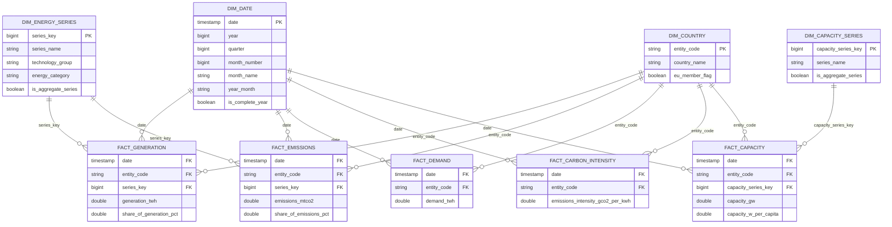
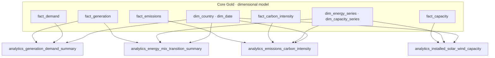

# Gold Data Model – Core ERD and Analytics Marts

The analytical Gold layer uses a **Fact Constellation / Galaxy Schema**. Multiple fact tables represent different analytical processes while sharing conformed dimensions where their semantics are compatible.

## Fact Table Grain

| Fact table | Grain |
|---|---|
| `fact_generation` | Country × month × energy series |
| `fact_emissions` | Country × month × energy series |
| `fact_demand` | Country × month |
| `fact_carbon_intensity` | Country × month |
| `fact_capacity` | Country × month × capacity series |

## Key Strategy

- `dim_date` uses the monthly date as a stable natural key.
- `dim_country` uses `entity_code` as a stable business key.
- `dim_energy_series` uses `series_key` for generation and emissions.
- `dim_capacity_series` uses a separate `capacity_series_key` because capacity-series aggregation semantics can differ from generation and emissions.

The PK/FK relationships shown here are logical analytical relationships. Athena does not physically enforce these constraints.

## Analytics Gold reporting layer

The **Core Gold ERD above remains the authoritative dimensional model**. The four reporting marts are derived country-and-comparison-period datasets, not additional fact tables at the monthly grain. They have no physically enforced foreign keys in Athena and should not be drawn as if they join directly to `dim_date` at month grain.

### Reporting marts and lineage

All four marts derive year boundaries from Core Gold date coverage. The edges show **SQL derivation dependencies**, not database foreign-key constraints. The last two marts expose `country_name` but **not** `entity_code`, so they cannot be joined to `dim_country` on a code without a schema change or a separate mapping.

### Reporting-mart grain and logical keys

| Analytics Gold table | Grain | Logical uniqueness checked at publication |
| --- | --- | --- |
| `analytics_generation_demand_summary` | Country × start year × end year | `country_name, start_year, end_year` |
| `analytics_energy_mix_transition_summary` | Country × start year × end year | `country_name, start_year, end_year` |
| `analytics_emissions_carbon_intensity` | Country × start year × end year | `country_name, start_year, end_year` |
| `analytics_installed_solar_wind_capacity` | Country × start year × end year | `country_name, start_year, end_year` |

These are logical analytical grains. Athena/Glue do not enforce primary-key or foreign-key constraints. See the [data dictionary](../data_dictionary/data_dictionary.md) and [versioned SQL](../../sql/analytics/) for exact measures.

The Core Gold ERD contains **nine tables** (four dimensions, five facts); the lineage diagram above documents the separate Analytics Gold marts. The pipeline additionally publishes four country-level Analytics Gold tables through Athena UNLOAD, S3 Parquet and Glue: `analytics_generation_demand_summary`, `analytics_energy_mix_transition_summary`, `analytics_emissions_carbon_intensity` and `analytics_installed_solar_wind_capacity`. They compare 2019–2025 and are additive to Core Gold. Verified reporting rows (2026-10-14): **38 / 38 / 38 / 10**; Core Gold is configured for 41 European markets and installed capacity ingestion for 13.
